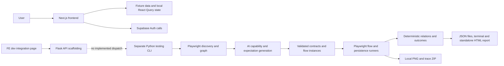

# BlindSpot current state

Assessment date: 2026-10-28. This is a source inspection, not certification of a deployed system.

## Scope and evidence

Three local repositories are available and were inspected:

- **BE**: `BlindSpotBE`, this repository. Flask API and deployment scaffolding.
- **FE**: `../BlindSpotFE`. Next.js product UI and Supabase authentication calls.
- **Engine**: `../blindspottest`. Python CLI, discovery, AI adapters, knowledge engine, Playwright runners, reporting, and a demonstration application.

References below use these prefixes and exact paths/functions. Sibling repositories are readable but are outside this repository's authorized write scope. The sibling `../test` directory has no application source visible. No other repository or remote service implementation was available. Installed libraries, generated build outputs, Git internals, and bundled third-party skills are not treated as application implementation.

Existing worktree changes were present before this analysis: BE `.env.example`, `README.md`, `backend/main.py`, plus untracked deployment/template/test files; FE `.env.example` and untracked integration/deployment/audit files; Engine untracked `.DS_Store`. Findings describe the current local files, including those changes, rather than an assumed clean commit. Secrets in actual `.env` files were not read.

Verification performed:

- Inventoried application source, configuration, tests, workflows, schemas, routes, and frontend callers across all three repositories.
- Parsed 118 Python files across BE and Engine with `ast.parse`; syntax inspection passed. This establishes syntax only.
- Attempted `python3 -B -m unittest discover -s tests -v` in BE. Test discovery failed importing Flask: `ModuleNotFoundError: No module named 'flask'`. None of the six CORS tests executed successfully in this environment.
- Browser tests, FE test/build suites, live model calls, GitHub/Jira requests against team resources, deployed endpoints, and database connections were not executed. No dependency installation or environment changes were made. Engine tests contain browser and model-double coverage, but their presence is not proof that current live integrations pass.

No application code, database, environment, configuration, commits, or deployments were changed. Only the six requested planning documents were created.

## Architecture today

There is no connected product pipeline from FE through BE to Engine. `AI_SERVICE_URL` and `AI_API_KEY` in BE are read but never used. Empty module files in BE are not duplicates of the implemented Engine modules: `discovery/crawler.py`, `discovery/page_inspector.py`, `semantic/classifier.py`, `semantic/schemas.py`, `knowledge/engine.py`, `runner/runner.py`, `reporting/reporting.py`, and `backend/auth.py` are all zero bytes.

## Feature classification

“Fully implemented” below means a bounded code path exists; it does not imply live deployment validation.

| Feature | Classification | Code evidence and limits |
|---|---|---|
| Health handler | Fully implemented | BE `backend/main.py:health_check` returns JSON status; dependency missing in attempted local test. |
| Browser CORS handling | Fully implemented | BE `allow_frontend_origin` uses exact environment-configured origins, exposes allowed headers on OPTIONS, adds `Vary: Origin`; `tests/test_cors.py` has six checks. CORS is not authorization. |
| Project/environment/account creation | Implemented but potentially broken | Legacy POST functions `create_project`, `environments`, `accounts` echo payloads and report success without saving anything. Project creation returns 201 despite no persistence. |
| Product data APIs | Partially implemented | GET projects/environments/flows/dashboard/runs/steps/failures/artifacts/logs and mutations in BE `backend/main.py:142–477` return 501. Route shapes and response sketches exist; services do not. |
| Start/rerun execution | Not implemented in BE | `run_test` returns `status: 1` with no engine call; `rerun_test` is 501. No dispatch process. |
| FE architecture/navigation | Fully implemented UI shell | FE `src/app`, `src/shared/ui/app-shell.tsx`, `src/app/providers.tsx`: App Router, React Query, reusable shell, theme and navigation. Next 16.3.8/React 19.2.8 declared in `package.json`; build not verified. |
| Dashboard and run detail | Partially implemented | FE overview and run pages render real UI using fixture hooks, not backend results. |
| Flow creation/planning | Partially implemented | FE `use-flow-editor.ts` validates a form and updates query cache; `draft-plan-for-goal.ts` returns three template steps. No AI request or durable save. |
| Live status | Implemented but potentially broken as product behavior | FE `use-live-run-events.ts` invokes `startLiveRunEmitter`, driven by fixture timeline; BE event routes return 501. UI can look live without execution. |
| Browser discovery | Fully implemented engine code path | Engine `discovery/crawler.py:Crawler`, `graph.py:AppGraph`, `page_inspector.py`, `readable.py`, `checkpoints.py`, `stability.py`, `coverage.py`, `policy.py`. Bounded graph traversal, input/control snapshots, observed transitions, checkpoint and coverage logic. Not an exhaustive arbitrary-site guarantee. |
| Flow execution | Fully implemented engine code path | Engine `runner/flow_runner.py:FlowRunner`, `runner/persistence_runner.py:PersistenceRunner`, `knowledge/flows.py:FlowEngine`, `main.py:_run_flows/run_baseline/run_regression/run_adhoc`. Browser runtime not exercised in this assessment. |
| AI providers | Partially implemented product integration | Engine `semantic/classifier.py:OpenAIBackend/AnthropicBackend/backend_for` call SDKs; FE/BE do not invoke them. Provider credentials, SDK availability and configured model access remain unverified. |
| AI expectations | Partially implemented against updated purpose | Engine `regression/expectations.py:generate_expectations/compile_expectations` infers intended behavior from discovered flows. Does not retrieve business documentation or preserve GitHub requirement IDs. |
| Reviewed behavior contracts | Partially implemented | Engine `knowledge/contracts.py:BehaviorContract/load_contracts/apply_contract` supports source string, reviewer, inferred/confirmed review, fixtures, UI/API checks, cleanup. File-based contract review is not PM finding approval. |
| Requirement outcomes | Partially implemented | Engine `knowledge/engine.py:decide` and `knowledge/flows.py:evaluate_instance` provide holds/violated/inconclusive. No complete imported-requirement inventory, explicit not-tested result or PM coverage API. |
| Regression analysis | Fully implemented engine code path | `regression/differ.py`, `findings.py`, `results.py`, `ui_differ.py`, `interpreter.py`; compares frozen semantics, distinguishes existing violations, changes, fixes and execution problems. Not all differences are bugs. |
| Screenshots/traces | Partially implemented product integration | Engine `FlowRunner.run` records PNG and trace with `artifacts_dir`; CLI baseline/regression flow paths supply this. No artifact storage/service integration. Persistence-only paths lack equivalent artifact wiring. |
| Video | Not implemented | No `record_video_dir` in application engine code. FE `playwright.config.ts` enables trace on first retry for FE tests only, without video. |
| PM findings review | Not implemented | No finding approval/rejection endpoint/table/component. Discussion is local state, unrelated to approval. |
| GitHub requirement integration | Not implemented | No GitHub content/issues importer. GitHub Actions CI is separate from application integration. Branch/PR fixture metadata does not establish GitHub connectivity. |
| Jira | Not implemented | No client, configuration contract, issue creation endpoint or stored issue IDs. |
| Product database | Not implemented | No BE models/migrations/DB connection, no FE product table queries. Supabase Auth calls do not establish a product schema. Remote Supabase tables cannot be determined from source. |
| Engine persistence | Fully implemented local scope | JSON baselines/reports/checkpoints via `baseline/saver.py`, `baseline/loader.py`, `reporting/*`, `discovery/checkpoints.py`; SQLite model reservation/response ledger in `semantic/budget.py`. Not a product database. |
| User authentication | Partially implemented | FE Supabase sign-in/sign-up/reset/update/sign-out in `features/auth/services/auth-service.ts`; login handles failures, redirects to fixed project. Server cookie helper exists. BE `auth.py` empty; no token validation/project access checks. |
| Route protection | Implemented but potentially broken | FE `(app)/layout.tsx` renders shell without session check. No application proxy/middleware found; comment in Supabase server helper anticipating Proxy is not implementation. Deployment access policies unknown. |
| Error handling | Partially implemented | Engine uses structured errors/inconclusive results; FE reusable boundaries exist. BE has no shared JSON exception handlers; most stub errors are not shared error envelopes. |
| CI/CD | Partially implemented/remote state unknown | FE and Engine workflows exist; BE startup configs exist. Actual successful CI, Cloud Build trigger setup and deployment health cannot be determined locally. |

## Backend/API detail

BE `backend/main.py` holds all HTTP handlers in one Flask module. `requirements.txt` declares only Flask and Gunicorn. There is no HTTP AI client, ORM or task runner dependency in BE.

Legacy endpoints at lines 41–131 include POST `/api/create-project`, `/api/dashboard`, `/api/accounts`, `/api/environments`, `/api/projects/<project_name>`, `/api/projects/<project_name>/flows/<flow_id>`, and `/api/projects/<project_name>/run-test`. Their responses are placeholders, sometimes successful-looking. New API declarations include project and environment reads, flow reads, GET dashboard, environment-scoped run history/detail/reruns, child results/artifacts/download/logs/AI usage, regressions/comments/notifications, public event streams and internal result/usage callbacks. They all return 501. `docs/frontend-api-design.md` is an intended contract, not implemented persistence, ownership, streaming or idempotency.

`request.get_json()` is used without field/schema validation. Missing/wrong content types and malformed JSON can produce Flask default HTML errors. There is no registered `@app.errorhandler`, request correlation ID, application structured logger, dependency timeout handling or persisted run status. Gunicorn access/error logging is configured by `Procfile`; it is not equivalent to job-level diagnostics. Development startup has `debug=True`; production entrypoints use Gunicorn instead.

## Engine: what can be reused

1. **Discover**: `Crawler` produces states and observed action paths; snapshots/readable values ground selectors. Checkpoints, depth/state/transition limits and graph coverage avoid claiming a complete crawl when limits stop traversal.
2. **Classify**: `semantic/classifier.py` classifies editable persistence candidates; `flow_classifier.py:build_user_prompt/classify_flows/validate_flow_candidates` names capabilities and validates graph references. Navigation is built from observed paths, rather than unconstrained model-generated executable code.
3. **Define expectations**: `regression/expectations.py:ExpectedBehavior` has descriptions, expected outcomes, relations, observations, evidence, assumptions, support level, confidence and severity. `validate_expectation` checks timeline/state/selector references; `compile_expectations` rejects unsupported or low-confidence checks and returns skips/gaps. Current prompt explicitly forbids invented business requirements but has no supplied requirements channel.
4. **Execute/evaluate**: `FlowRunner` isolates each test in a new context, performs setup/goal/verification/cleanup, records observations. `runner/observation_points.py`, `contract_checks.py`, `outcomes.py` support scheduled observations, typed UI checks and constrained API assertions. `evaluate_instance` guards execution/observation/cleanup failures before calling deterministic `decide`. Preserve these distinctions.
5. **Persist/replay**: JSON baseline records retain instances, observations, evidence notes and semantics signatures. `regression/results.py` detects non-comparable tests and execution failure. Requirements validation can use direct outcomes; it need not first establish a passing baseline, and an existing violation still matters.
6. **Explain**: `regression/interpreter.py` groups and explains deterministic findings; validates cited subjects and cannot change engine verdicts. Extend this grounding with requirement/result IDs.
7. **Budget**: `semantic/budget.py` reserves calls/tokens, caches exact requests in SQLite, blocks automatic retries of unknown/failed calls. It tracks usage/reservations, not reliable USD billing.

`semantic/classifier.py` constructs system/user messages and strict JSON schemas, then parses and validates outputs. Adapters disable SDK retries, check refusal/truncation and capture usage. Engine defaults contain model identifiers whose actual account availability was not tested; explicitly select a verified provider/model during implementation instead of assuming defaults work. No model migration is needed for this plan.

Existing tests include `tests/test_ai_expectations.py` (model double plus browser replay), `test_expectation_validation.py` (assertion typing), `test_browser_contracts.py` (browser contracts, API assertions, stale paths, cleanup), `test_behavior_regression.py`, `test_regression_v2.py`, `test_crawl_checkpoints.py` and `test_model_budget.py`. Synthetic fixture success does not prove behavior on the intended application.

## Evidence caveat

Engine `runner/flow_runner.py:546–572` starts tracing only when artifacts are enabled, calls `_run`, then captures a screenshot and stops tracing. `_run` performs cleanup/teardown before returning. The PNG may therefore show cleaned-up state rather than the failure. `tracing.stop` is not protected like the screenshot operation and can raise, obscuring an otherwise valid result. Context closure is in `finally`; interrupted execution does not guarantee a completed evidence manifest. Evidence is stored as local paths in result notes and baseline records, not authorized web URLs. There are no per-action screenshot associations equivalent to those proposed by BE APIs.

## Frontend truth and cleanup inventory

| Current display/control | Verified implementation | Recommendation |
|---|---|---|
| Projects/header project/environment selectors | `app/projects/page.tsx` hardcodes Acme; `app-shell.tsx:TopHeader` uses static options without selection handlers | One persisted project/target is sufficient; remove misleading environment choices until wired. |
| Tests/pass rate/weekly AI cost | `OverviewCounters.tsx` counts/sums supplied fixture runs; denominator includes all statuses, no weekly time filter | Replace with requirement coverage and outcome counts; display unknown cost as unavailable. |
| Regression alert/PR/deployment | `RegressionsFirst.tsx` hardcodes Checkout, PR #482 and deployment/time text | Remove unless backed by stored references. |
| Runs, failures, screenshots and logs | `use-runs.ts`, `use-run-detail.ts` return fixtures; SVG screenshots and logs are generated | Production demo must use API data and captured evidence exclusively. |
| Live/complete/checkmarks | `use-live-run-events.ts` consumes fixture emitter; `step-row.tsx` and `status-config.ts` display supplied pass/healed states | Only show completion after real observations. Do not advertise healing. Check icon in `EvidencePanel.tsx` is a legitimate clipboard acknowledgment, not feature completion. |
| “Configured Steps” | `flows/[flowId]/flow-detail-content.tsx` calls `useRunDetail("run-4821")` | Render actual saved expectation/flow configuration or hide. |
| Generate plan/save/queued flow | `draft-plan-for-goal.ts`, `use-flow-editor.ts` produce templates and query-cache objects | Label local draft honestly; replace save with persisted expectations before claiming queued/executable. |
| Rerun/download trace | `runs/[runId]/run-header.tsx` uses alerts | Wire or disable with an explicit unavailable label. |
| Last passing/first failing | `run-detail-content.tsx` calculates last passing as current run number minus one | Require actual baseline link; otherwise omit. |
| Click marker/browser URL | `evidence-pane.tsx:buildFrameProps` fixes click at 50/45 and uses store.acme.dev | Omit marker unless captured; use observed URL. |
| Comments | `discussion-tab.tsx` seeds engineer comments and appends local state | Hide for MVP; PM review gets separate persistent actions. |
| Environment protection badge | `EnvironmentCards.tsx` stores a boolean in local state, no executor enforcement, no base URL field | Do not present policy as enforced. Use server-enforced allowlisted target. |

FE error primitives (`AsyncBoundary`, `InlineError`, route `error.tsx`) can be reused. Most application hooks never issue requests, so backend errors never reach them. Run detail shows a generic message without the underlying backend cause. `/dev/integration/page.tsx` is the exception: real fetch, 15-second timeout, status checking and Zod parsing, with an honest 501 explanation. Reuse the approach in a shared client, including parsing structured server messages.

## Authentication and delivery

Retain current Supabase forms; do not spend Timebox 4 on role systems, onboarding or password feature expansion. Existing forms call a real SDK but account configuration and successful sessions are unknown. A restricted team demonstration can proceed with one project and a named PM reviewer without claiming production identity guarantees. If publicly exposed, enforce an existing access gate or minimal token validation before enabling mutations; a dropdown and CORS do not protect APIs.

FE `.github/workflows/ci.yml` (workflow name CI) runs npm install, lint, typecheck, Vitest and build on main/integration pushes/PRs. It does not run the FE Playwright demo-path spec. Engine `.github/workflows/tests.yml` (“Regression checks”) installs Python dependencies and Chromium, invokes `make test` and `make regression-benchmark`, and uploads benchmark artifacts. These are test workflows, not evidence of product GitHub integration or successful remote runs. BE has no `.github` workflow. `Procfile` uses Gunicorn; `.python-version` selects 3.13 while `app.yaml` declares App Engine Python 3.14, an alternate deployment path. README describes Cloud Run/Cloud Build but live trigger/service state is unverified.
