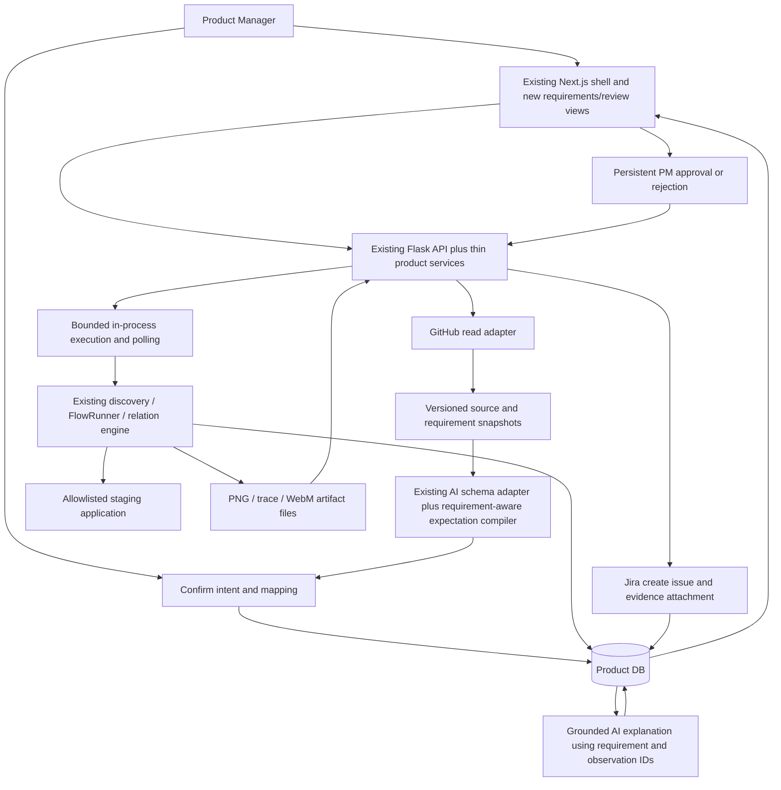

# Proposed architecture: one thin product integration around the existing engine

This is a proposal. None of the new endpoints, tables or modules described here exists yet. See [CURRENT_STATE.md](CURRENT_STATE.md) for code-backed facts.

## Deployment boundary and smallest viable choice

For Timebox 4, choose a **single-machine, single-project, restricted team demo**: Next.js frontend, existing Flask API, the existing Python engine installed/pinned as a package, private local artifact directory, and one SQLite product database. Keep the existing SQLite model-budget ledger separate from the product database. One bounded background executor in the Flask process is enough for this demo when run in one long-lived process without a reloader; serialize browser jobs and persist their states. It is not a durable cloud scheduler.

On startup, reconcile abandoned running jobs to interrupted/error; explicitly retry into a new run. A crash after a queued row is saved may leave it pending: scan and claim queued rows on startup and periodically. Use a transaction/claim token and one active execution limit so duplicate requests do not run the browser twice. Reject additional work with an honest busy response if capacity is exhausted. Do not use Flask request globals inside background execution.

Do not reuse the current multi-instance cloud defaults unchanged for local SQLite or ephemeral files. If hosting is a grading requirement, decide that before implementation: use durable PostgreSQL and object storage and a continuously running, single executor process with DB-backed claims/leases. This adds deployment work; do not rely on post-response threads surviving scale-to-zero. No microservices, external queue, Redis, Celery, event bus or separate AI service is required. Hosted reliable scheduling beyond this limited model is deferred.

## Data flow and state semantics

1. PM selects repository, resolved commit/ref, file path and section. Server fetches a bounded file and stores text, hash and source URL. First support README/Markdown/text BRDs; selected issues follow.
2. Extract atomic requirements with exact source quotations/anchors and category. The model must distinguish facts from assumptions and unsupported statements. PM confirms or edits the intended expectation; retain original and reviewed revisions.
3. Map expectation to an existing discovered flow/entry and validated observations. PM may select functionality when automatic mapping is ambiguous. Unmapped requirements stay visible.
4. Starting analysis freezes source, requirements, expectations, mapping, target build identifier when available, engine version, prompt version, model and execution configuration. Reuse frozen instances; do not regenerate expectations midway through a run.
5. Persist run before dispatch; return 202 with stable run ID/status URL. Poll every ~2 seconds while active, back off on transient failure, stop at terminal state. Display the three user-facing stages; detailed internal stage may include importing, planning, executing, explaining, finalizing.
6. Runner captures observed values and evidence before cleanup. Relation engine decides truth. AI explains evidence and business impact but cannot convert an engine error into a defect or change a verdict.
7. Persist result for every selected expectation, including never executed ones. PM reviews failed findings, sees evidence, approves/rejects with notes. Approval does not start a ticket automatically.
8. Explicit Create Jira action checks current approval, claims a unique operation, calls Jira and stores issue ID/key/URL. Evidence upload can be retried separately.

Keep three independent dimensions:

- **Run execution**: `queued`, `running`, `completed`, `error`, `interrupted`; with stage, timestamps, heartbeat, error code and partial-results flag. “Completed” means analysis finished, not requirements passed.
- **Expectation result**: `passed`, `failed`, `inconclusive`, `not_tested`, with reason. Map engine `holds`→passed, `violated`→failed, `inconclusive`→inconclusive. Missing mapping/unsupported scope/skipped by limits→not_tested. An attempted check with inadequate evidence→inconclusive. Preserve both raw engine verdict and adapter mapping.
- **Finding review/ticket**: review `pending`, `approved`, `rejected`; ticket `none`, `creating`, `created`, `failed`, `unknown`. Artifact/AI explanation states are independent.

For multiple expectations per requirement: any reliable failure makes the requirement failed; otherwise any inconclusive result makes it inconclusive; otherwise any unexecuted expectation makes it not fully tested (display not tested/partial coverage); only all required expectations passed permits requirement passed. Always show child counts and reasons. A wholly unmapped requirement is not tested, and an empty expectation list must never yield a pass. Report coverage separately from pass rate.

## Minimum relational schema

Use migrations from the first implementation, including SQLite foreign-key enforcement. Do not migrate the engine budget journal into these tables.

| Entity | Minimum fields / invariants |
|---|---|
| `projects` / `environments` | Stable IDs; project relation; display name; allowlisted base URL; optional observed build/SHA. One of each is enough. |
| `requirement_sources` | Project, kind (`github_file`, `github_issue`, `text_brd`), repository/path or issue number, resolved commit for files, issue updated time for issues, source URL, immutable raw text/hash, fetched timestamp. Issues are mutable and are not pinned by repository commit. |
| `requirements` | Source revision FK, external/stable key, source anchor and quote, requirement text, category (`functional`, `business_logic`, `ux_design`), automation disposition/reason, interpretation revision and confirmation metadata. |
| `expectations` | Requirement FK, revision, description, expected outcome, relation and observation bindings, discovered flow reference/mapping snapshot, assumptions/gaps, support/confidence, confirmation status and contract JSON. Multiple checks per requirement. |
| `runs` | Project/environment, idempotency key unique per project, immutable selected requirement/expectation/config snapshot, execution status/stage/error, created/started/finished/heartbeat timestamps, claim token, engine/model/prompt versions. |
| `validation_results` | Run + expectation revision unique; requirement revision FK/snapshot, outcome/reason, raw verdict, expected/actual values, observation JSON, action/reproduction log and duration. Rows precreated as not tested, updated only from actual execution. |
| `findings` | Result FK, requirement ID, category, headline, expected/actual narrative, impact/severity, confidence and its basis, recommended action, explanation status. Do not invent failure findings for every skipped requirement. |
| `artifacts` / `finding_artifacts` | Run/result IDs, optional finding/action association, type/MIME, private storage key, size/hash, captured time and observation/video offsets, capture status; many findings may cite one artifact. No raw OS paths in public payloads. |
| `reviews` | Finding, decision, note, reviewer display identity, time and version. Append audit records; optimistic locking avoids overwriting concurrent decisions. No new role system. |
| `jira_exports` | Unique finding + Jira site/project, operation ID/idempotency key, finding/review snapshot hash, status, issue ID/key/URL, error code, attempted time, evidence upload statuses. Keep unknown outcomes for reconciliation. |

Store operational fields relationally and engine payloads as bounded JSON, avoiding a rewrite of existing dataclasses. Retain immutable snapshots even if source requirements change. Requirement revisions used in previous runs are never overwritten. P0 duplicate prevention is per approved finding; optional cross-run fingerprints can suggest an existing ticket later without silently merging separate defects.

## HTTP contract

Let `P=/api/projects/{project_id}`, `E=P/environments/{environment_id}`, `R=E/runs/{run_id}`. Reuse existing route prefixes where possible. All lists use `items` and optional cursor; bound request bodies and page sizes.

| Endpoint | Action and response |
|---|---|
| Existing GET `/api/projects`, GET `/api/environments?project_id=...` | Implement reads for persisted single-project target; do not build broad project admin UI. |
| New POST `P/requirement-sources` | Import specified GitHub file/section or bounded text BRD; 201 source snapshot. Fetch failure is an error, never a successful empty requirement list. |
| New POST `P/requirement-sources/{id}/interpretations` | Extract/interpret into draft requirement/expectation revisions; bounded synchronous call initially, persisted job if latency requires it. 201 on complete; do not falsely return a completed interpretation on timeout. |
| New GET `P/requirements` | List source-linked requirements, confirmation/mapping/support and coverage for chosen run. |
| New PATCH `P/requirements/{id}` | Confirm/edit interpretation and mapped expectation revisions with version check; do not mutate past run snapshots. |
| New POST `E/runs` | Canonical start: expectation revision IDs, source revision, target ID; require Idempotency-Key. 202 stable persisted run plus status URL. Retire legacy `POST /api/projects/<name>/run-test` or delegate after unambiguous ID resolution. |
| Existing GET `E/runs`, GET `R`, GET `R/steps` | Implement actual rows and execution states; child actions can remain a bounded list in step detail for MVP. |
| New GET `R/results`, GET `R/findings` | All four outcomes and structured failure findings; `R/failures` may serve an explicit compatibility projection if still used. |
| Existing GET `R/artifacts`, POST `R/artifacts/{id}/download` | Metadata plus local restricted content URL or short-lived hosted URL; new GET content route resolves opaque ID to safe storage key. Support browser video range requests where practical. |
| New PATCH `R/findings/{id}/review` | `decision`, `note`, `version`; 200 saved review, 409 stale version. |
| New POST `R/findings/{id}/jira` | Approved-only, unique operation; 201 created, 200 existing export, 409 not approved/in progress/uncertain outcome. Never create twice on repeated click. |
| New POST `R/findings/{id}/jira/evidence-retry` | Retry missing attachment for existing issue; does not recreate issue. Can defer UI if operation exposed through same export service. |
| Existing GET `/api/dashboard` | Requirement outcome/coverage, review-pending and ticket counts for selected run; remove unsupported QA cost/regression metrics. |

Do not implement SSE, callback ingestion, cost finalization or notifications for MVP. Replace the mock emitter with polling. Use a small versioned result adapter for the engine. FE and BE must agree one actual payload, rather than reusing incompatible placeholder shapes. Current FE `run.schema.ts` requires flat identities/non-null cost/times and replay/agentic modes, while BE sketches nested identities/null pending values. Introduce explicit v1 product schemas and coordinated mappers; do not fill unknown fields with made-up values.

## AI contract changes

Extend `regression/expectations.py` packet and schema instead of replacing generation:

- Inputs: immutable requirement ID/revision/text/quote/source, confirmed business definitions/test data, discovered states/controls/observed paths, optional design reference and viewport.
- Outputs: requirement ID, flow ID, expected outcome, supported relation/observations, category, support disposition, assumptions, confidence and explicit gaps. Validate returned IDs/quotes/selectors and data types server-side. Quote matching is provenance checking, not proof of correct interpretation.
- Requirement text supplies intended behavior; observed UI supplies locators/actions and actual values. Neither repository nor page content can override system instructions. Reject executable generated code and arbitrary URLs.
- Missing mappings stay not tested; unsupported expressions become gaps. Keep existing typed relation/function allowlist and budget checks. Preserve mandatory engine execution guards.
- Findings explanation input includes only actual result/observation/artifact IDs and frozen requirements. Require evidence citations and expected/actual distinction. Store model/prompt/input hashes; reject nonexistent references. Confidence describes interpretation/evidence sufficiency, not a calibrated probability or permission to skip PM review.
- If explanation generation fails, retain deterministic result and show explanation unavailable. If the only possible verdict is subjective, mark for human judgment; do not invent a deterministic pass.

## Evidence/video implementation

Extend the **inner context created by `FlowRunner.run`**, not only `main.py`'s outer browser page, with `record_video_dir` and fixed viewport/video size. Record action and observation monotonic offsets; capture the failure-state screenshot before cleanup. Close context before resolving/finalizing video paths, then register actual file metadata. Keep capture errors distinct from correctness results. Trace stop should not discard an evaluated run.

Use original per-test WebM first. For a focused single interaction, a roughly 10-second run may meet the feedback without editing, but duration must be measured rather than padded or asserted. Longer workflows get a highlighted time range and full recording. This is not a physically trimmed clip. A true downloadable ~10-second clip needs optional FFmpeg processing after close; retain the full original, clamp offsets, test playback/keyframes, record original→clip linkage, never rerun a state-changing checkout just to obtain a video. Mark physical trimming P2 unless the instructor makes it mandatory.

Local demo: private artifact folder outside public FE assets, bounded retention (proposed 7 days), explicit cleanup after the demonstration and no passwords/payment secrets in fixtures. Hosted: private object storage, authorization/access gate and short-lived download URLs. Jira receives a stable finding page URL, not a signed URL that expires. Attach PNG/WebM directly when Jira policy/size permits; if only local URLs exist, attachments are necessary for evidence to be useful to remote Jira users. Video failure leaves screenshot + trace visible with an honest missing-video message.

[Playwright's video documentation](https://playwright.dev/python/docs/videos) specifies context recording and closure before saved video is available. No video-trimming feature is supplied by that mechanism.

## GitHub and Jira adapters

**GitHub**: call repository Contents API for explicitly selected README/Markdown paths at a resolved commit; use API metadata/raw content, byte limits and an allowlisted GitHub host. Cache by repository/path/SHA/content hash. Public repository first; a server-held read-only token only when needed. Add selected Issues as P1; filter pull requests, handle pagination/rate limits, and snapshot mutable content. Binary PDF/DOCX BRDs need extraction/OCR and layout review and are P2; textual BRDs support the same business content without that pipeline. [GitHub Contents API](https://docs.github.com/en/rest/repos/contents), [GitHub Issues API](https://docs.github.com/en/rest/issues/issues).

**Jira Cloud assumption, to confirm**: use one team-controlled demo Jira site/project and backend-held integration credential. A simple internal demonstration may use email + API token; a distributable customer integration needs a different authorization design, not collection of users' tokens. See [Atlassian authentication guidance](https://developer.atlassian.com/cloud/jira/platform/basic-auth-for-rest-apis/). No full BlindSpot user-auth rebuild is necessary.

Validate Jira project/issue type/required fields before rehearsal. Create via `POST /rest/api/3/issue`; use Atlassian Document Format for description with requirement/source revision, expected and actual observations, severity/business impact, steps, environment/run and stable evidence link. Configure priority mapping; do not assume a custom severity field exists. Persist response issue ID/key and construct site `/browse/{key}` URL. [Jira issues reference](https://developer.atlassian.com/cloud/jira/platform/rest/v3/api-group-issues/).

Upload attachments after issue creation using `POST /rest/api/3/issue/{key}/attachments` and multipart with `X-Atlassian-Token: no-check`, subject to enabled attachments, permissions and size limits. Store attachment IDs/status separately. [Jira attachment reference](https://developer.atlassian.com/cloud/jira/platform/rest/v3/api-group-issue-attachments/).

Use a unique DB export record and serialized claim before calling Jira. Include a stable BlindSpot operation marker in the issue description/label for reconciliation. Jira create is not assumed to honor our Idempotency-Key. A timeout/crash after remote success can leave local status unknown: do not blindly resend. Reconcile the operation marker with the remote issue (or allow an operator to link an existing verified key); only retry when non-creation is established. This is duplicate resistance, not distributed exactly-once delivery. Rejection before export prevents creation; rejection after a ticket exists requires a PM warning and does not delete Jira issues.

## Errors and operational constraints

Return `{"error":{"code":"...","message":"...","retryable":false},"request_id":"..."}` with appropriate 400/422/404/409/429/502/503/504/500 statuses. Translate Werkzeug errors too. Redact tokens/request secrets in logs; log run/requirement/request IDs and dependency failure class. Never echo credentials or full target session contents.

Add a shared FE fetch helper with timeout/abort, status checking, content-type-safe JSON error parsing, schema validation and actionable messages. Distinguish empty results from unavailable data. Preserve PM inputs on failure and disable duplicate submissions. Poll errors show last known job state and a retry connection action, not a fabricated run failure.

Restrict browser targets and redirects to approved development/staging hosts and safe test data, with bounds on crawl depth/actions/time/model budget. Existing engine operations mutate target applications. Do not expose arbitrary URL browsing on an unauthenticated public API. Keep broad authentication, multi-tenancy and credential vault work deferred; use a restricted demonstration boundary.
